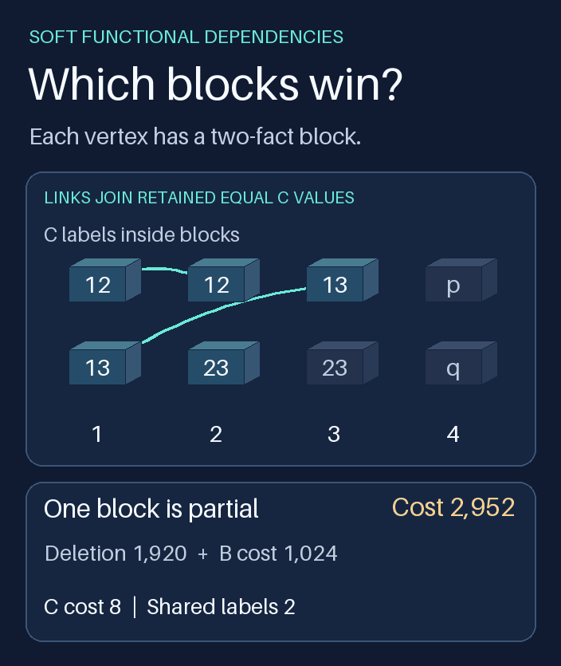

# Soft repair with two functional dependencies sharing a left-hand side

  

Exact soft repair is NP-hard for the fixed dependencies A→B and A→C on R(A,B,C). The decision version is NP-complete with one A value, a common positive integer deletion cost and penalty one for A→C. The other numerical penalty is supplied as input.

[Read the paper](paper/manuscript.pdf) · [LaTeX source](paper/manuscript.tex) · [Proof outline](proof/PROBLEM_AND_PROOF.md) · [Run the replay](REPRODUCIBILITY.md)

## Why the triangle wins

A high finite B penalty and the common deletion weight force an optimal repair to select full blocks. Three full blocks cost the same in the first two terms. The triangle retains all three shared edge labels and costs 2,828. Choosing the isolated block with two triangle vertices saves only one equal-label pair and costs 2,830.

[Download the offline explorer](https://raw.githubusercontent.com/DannyExperiments/soft-repair-two-common-lhs-dependencies/refs/tags/v1.0.0/visualization/soft-blocks-explorer.zip), extract it, and open `index.html`. Toggle any fact to see its exact effect on the repair score. [Figure guide](visualization/README.md)

## Source and scope

This is the first fixed dependency set listed as open by Carmeli et al. in TODS 2024 §7. Each unordered pair pays for every violated dependency. The reduction uses the source's numerical-input model and keeps the relational schema and dependency set fixed.

[Journal question](https://doi.org/10.1145/3651156) · [Conference question](https://drops.dagstuhl.de/storage/00lipics/lipics-vol186-icdt2021/LIPIcs.ICDT.2021.16/LIPIcs.ICDT.2021.16.pdf#page=16) · [Pinned Q1086](https://github.com/10m-u/open-problems-catalog/blob/ca8d4d44ba3db527f19f28928c240168f545ecfe/problems/computer_science_ai/classical-statistical-machine-learning.md#q1086)

[Mathematical audit](audits/public_safe_reports/MATHEMATICAL_AUDIT.md) · [Literature audit](audits/public_safe_reports/LITERATURE_AUDIT.md) · [Scope](CLAIM_SCOPE_AND_LIMITATIONS.md) · [AI disclosure](AI_DISCLOSURE.md) · [Status](STATUS.md)

[Release v1.0.0](https://github.com/DannyExperiments/soft-repair-two-common-lhs-dependencies/releases/tag/v1.0.0) · [Version DOI](https://doi.org/10.5281/zenodo.24572919) · [Citation](CITATION.cff)
